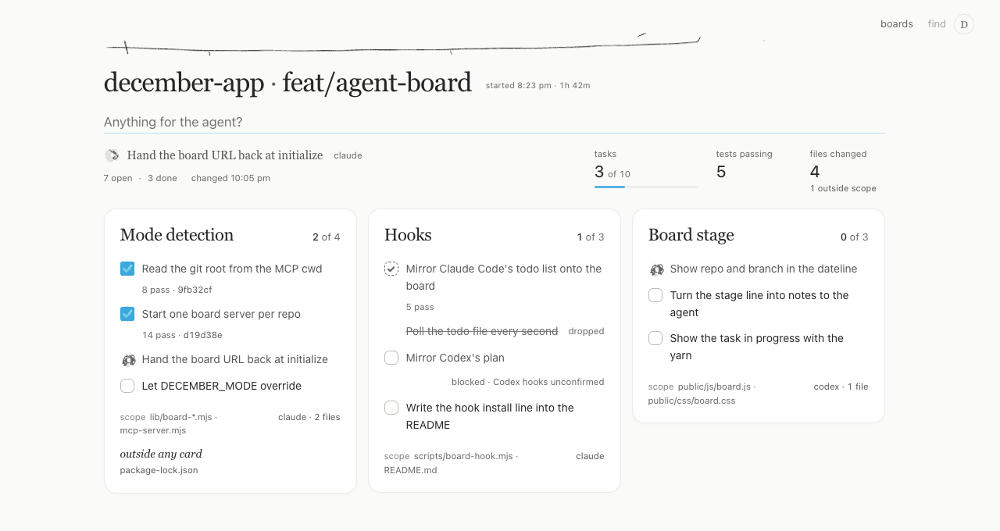
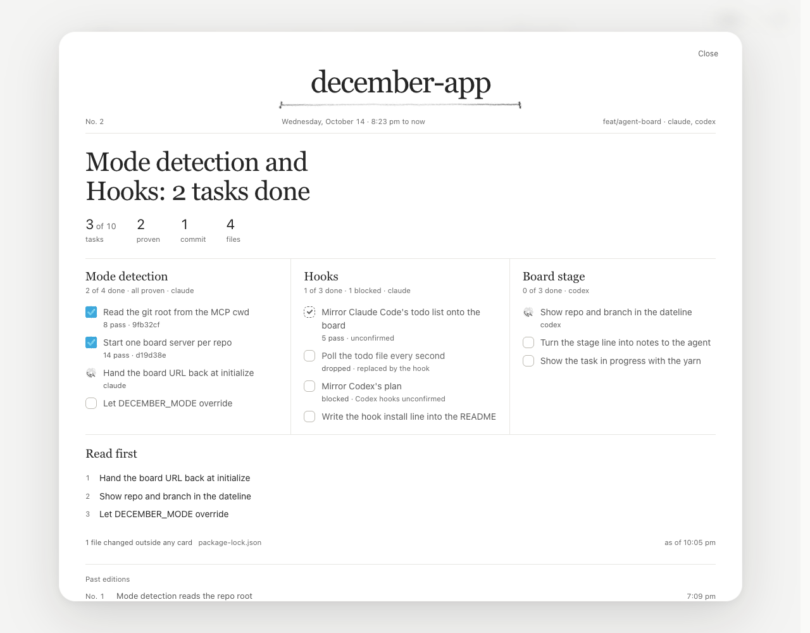

# Agent board mode

A coding agent keeps its tasks on a December board, and the person watches.
Nobody picks the mode: when December's MCP connection starts inside a git repo,
that repo gets its own board. Anywhere else the connection gets the person's page,
unchanged.



## How it works

1. At `initialize`, `mcp-server.mjs` finds the project: `CLAUDE_PROJECT_DIR` if
   the harness sets it, otherwise its working directory, then `git rev-parse
   --show-toplevel` (`lib/board-mode.mjs`). A git root means board mode, keyed by
   that root. `DECEMBER_MODE=page|board` overrides it. December's own organizer
   always gets the page.
2. `lib/board-host.mjs` keeps each board in its own store at
   `…/December/boards/<repo>-<hash>/`. It reuses the board's server if one
   answers, or starts a detached `server.mjs` with `DECEMBER_MODE=board` on the
   first free port from 3031, inside Codex's 10-second startup window.
3. The handshake instructions open with the board URL, then where the last
   session left off (its headline, what to read first, what is still open), then
   the board's manners.
4. If nobody has the board open 20 seconds after a session says hello, the
   server opens it in the system browser, once.
5. On a board, the organizer, Pocket, the watch and the journal stay off. What
   the person types waits at the end of the line as a note to the agent until the
   agent files it.

## The board's tools

| Tool | What it does |
| --- | --- |
| `december_task` | One workstream is one card. `add` plans tasks in order; `start` takes one in hand (one per agent, the last goes back to the plan); `done` closes it with proof; `block`, `wait`, `cancel` and `queue` move it with a reason. |
| `december_scope` | The paths a card may touch, as globs. A file changed outside any card's scope shows as drift. |
| `december_handoff` | Ends the session with a headline and what to read first. That becomes the session's edition. |

The page's own reading tools stay (`december_view`, `december_ask`,
`december_file_capture` and the rest); the person's tools (goals, About Me,
suggestions) are not offered. Every board tool's result carries `unread` (the
person's notes) and `drift` (stray paths), so the agent sees both without
asking.

### Proof

`done` takes `proof: { tests, commit, file, shot }`. The board checks it against
git before writing: the commit must exist in the repo, the file or screenshot
must be in the work tree. Checked proof paints the tick. Anything else leaves a
dashed tick, and the result says why. When the person ticks a task, that counts
as proof too.

### Sessions and editions

Activity from any agent joins the current session; 45 minutes of quiet, or a
hand-off, ends it. Each session is an edition, numbered. The dateline opens the
latest one: the headline, the figures, each card's tasks with their proof, what
waits on the person, and what to read first. A session that ends without a
hand-off gets an edition composed from what happened.



### Git

`lib/board-facts.mjs` reads the branch against its base (`origin/HEAD`, then
`main` or `master`): commits ahead, every changed file (committed, staged or
untracked), which card's scope covers each one, and when each stray file was
first seen. The page refreshes when git changes while someone is watching.

## Running on its own

- One server per board, started on demand and reused across sessions.
- Opened once in the browser when nobody is watching.
- Stopped after three idle hours with no one watching.
- The boards door (shown when there is more than one board) lists every board on
  the machine: waiting ones first, then working, then idle.

| Variable | Default | What it sets |
| --- | --- | --- |
| `DECEMBER_BOARDS_DIR` | `…/December/boards` | Where boards live |
| `DECEMBER_MODE` | detected | `page` or `board` |
| `DECEMBER_BOARD_OPEN` | on | `never` to never open the browser (tests and CI never do) |
| `DECEMBER_BOARD_OPEN_DELAY_MS` | `20000` | How long to wait for a viewer |
| `DECEMBER_BOARD_IDLE_MS` | `10800000` | Idle time before the server stops |

## Mirror Claude Code's todo list (optional)

`scripts/board-hook.mjs` is a PostToolUse hook. It mirrors `TodoWrite` (and
`TaskCreate`/`TaskUpdate`) onto one card, "Session plan", keeping each task's
state. It never starts a board, and it exits silently when there isn't one. Add
this to the repo's `.claude/settings.json` or `~/.claude/settings.json`:

```json
{
  "hooks": {
    "PostToolUse": [
      {
        "matcher": "TodoWrite|TaskCreate|TaskUpdate",
        "hooks": [{ "type": "command", "command": "node /path/to/december/scripts/board-hook.mjs", "async": true }]
      }
    ]
  }
}
```

If you set `DECEMBER_BOARDS_DIR` for the MCP server, give the hook the same value.

## Demo

```bash
node scripts/board-demo.mjs [--dir <folder>] [--fast]
```

The demo makes a scratch repo and connects to it over real MCP stdio, first as
`claude-code`, then as `claude-code` again and `codex-mcp-client` together. It
plays two sessions: a plan, real commits as proof, a hand-off, a held tick, a
blocked task, a stray file, a note from the person and an approval left waiting.
The board server keeps running afterwards. `--fast` plays it in a few seconds.
