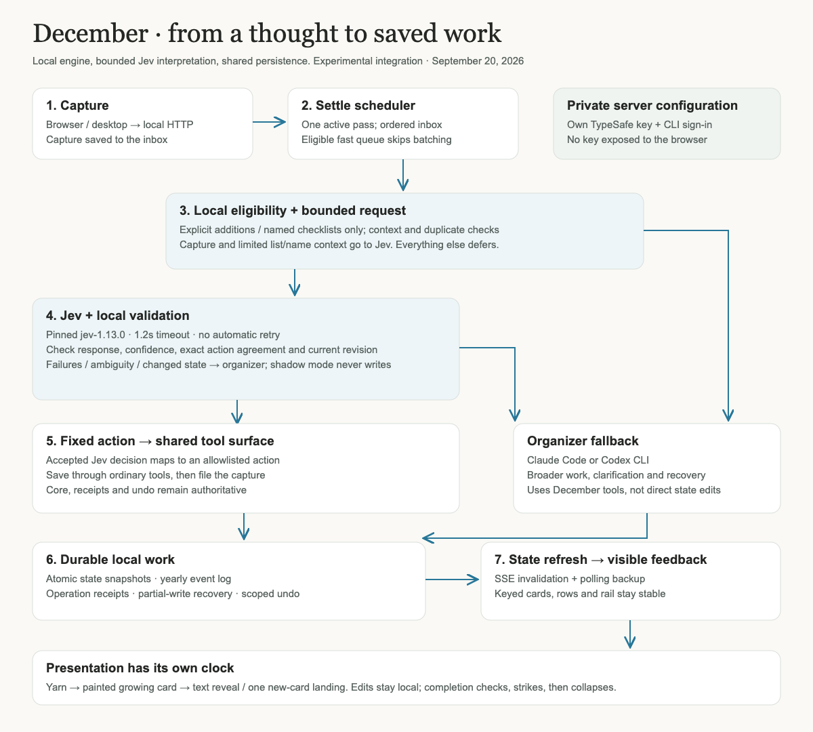

# December architecture — experimental integration

## Local runtime

December is a local Node HTTP application with a plain JavaScript/CSS client. Electron wraps the same local application for desktop use. The HTTP server binds to 127.0.0.1, serves the UI, validates requests and dispatches mutations through the shared tools/core. `mcp-server.mjs` exposes December organization tools to external clients. Pocket is an optional paired-phone transport; it is not the organizing engine.

## Capture to work

The browser sends a capture to the local server. The capture is persisted in the inbox before organizing. The settle scheduler prevents concurrent organizer passes; pending work triggers another pass. An eligible explicit queue of up to eight captures can bypass the usual 700ms batching delay. The live fast pass proceeds in inbox order and stops at its first fallback.

1. `lib/jev.mjs` parses only supported explicit list additions (including bounded comma-separated batches) and new named 2–8-item checklists. It checks context, names, duplicates and prior operation receipts locally. Existing lessons, unanswered questions, hints and partial operations require the organizer.
2. Jev receives capture text and bounded list/name context. `jev-1.13.0` is pinned; timeout is 1.2s. `jev-provider.mjs` has no automatic retry and opens a 15s cooldown after three transport failures, allowing a recovery probe.
3. The response must pass schema/model/confidence checks (0.95 experimental threshold), agree with the locally derived action, and pass a fresh page-revision/context check. Confidence is not a calibrated production reliability guarantee. Shadow mode evaluates without fast-path writes.
4. `capture-action.mjs` maps the accepted decision to a fixed tool and validated arguments. Jev never produces executable UI, arbitrary tool names or code. Mutation succeeds before capture filing; receipts preserve partial progress for recovery.
5. Unsupported, ambiguous, unavailable or rejected fast-path work stays for the configured Claude Code or Codex organizer. Claude uses a reusable process/session with rotation; Codex runs an organizing prompt through its CLI. Both use the same December tool surface. A missing/unauthed fallback can leave captures pending with an error; Jev does not replace this requirement.

## Persistence and recovery

`lib/tools.mjs` -> `lib/core.mjs` is the shared mutation boundary for UI, Jev and organizer work. Core writes state snapshots atomically and maintains yearly event logs. Stable capture/operation identities and durable receipts guard retries/partial writes; scoped undo lives in `undo-changes.mjs`. These are application safeguards, not an assertion that an external model or network provides exactly-once delivery.

## Browser feedback

Server-sent invalidations trigger coalesced state refresh, with polling as backup. Keyed reconciliation keeps cards, rows and rail links stable. Presentation has its own owners: yarn while working; painted canvas formation and grapheme reveal while building; spring-driven card dimensions; one flight per newly filed destination; localized existing-item changes; and check/strike/collapse for completions. Display animation is not the persistence transaction and must not hold saving hostage. Reduced motion, backgrounding and interruption release temporary state.

## Credentials and configuration

TypeSafe key stays in the server environment or a private key file. It is not sent to the browser, included in status payloads or bundled here. The live launcher checks configuration at startup and seeds a fresh review page. Real API calls transmit capture/context to TypeSafe; fallback transmits work to the selected CLI/provider. `data/settings.json` stores engine/model/path preferences after setup. That file is not included. Ordinary server startup defaults Jev off; the preview launcher explicitly selects fast mode. Simulation uses a separate data directory and cannot silently become live.

## Extension guidance

Keep provider interpretation separate from action construction, core mutation and animation. Add negative examples and stale-state/receipt tests before expanding fast actions. Keep new motion localized to the changed subject, not a global render event. Preserve unknown custom model IDs. Do not treat CLI presence or configured credentials as authentication validation.
